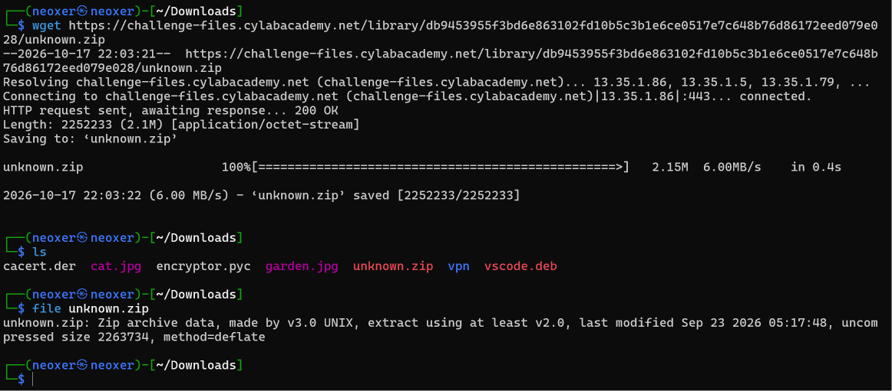
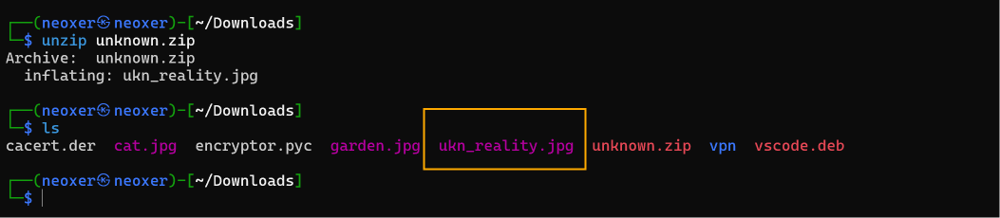
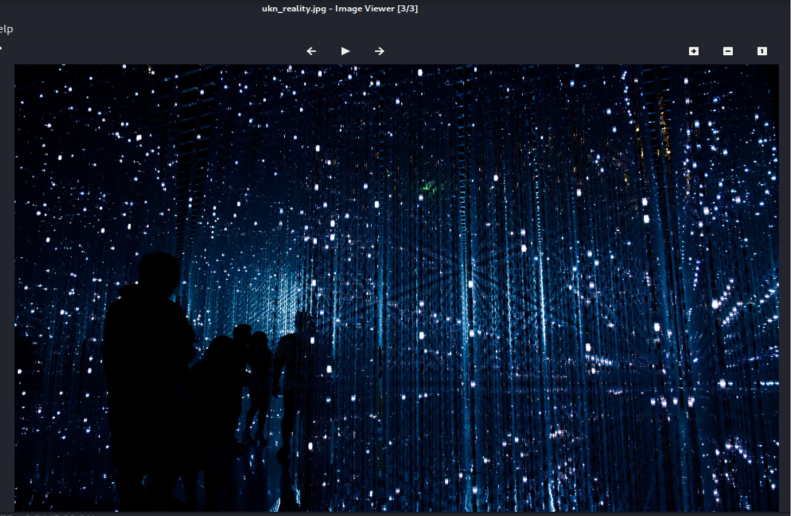
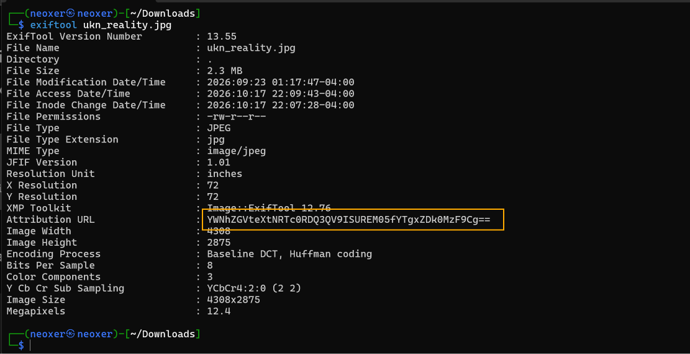
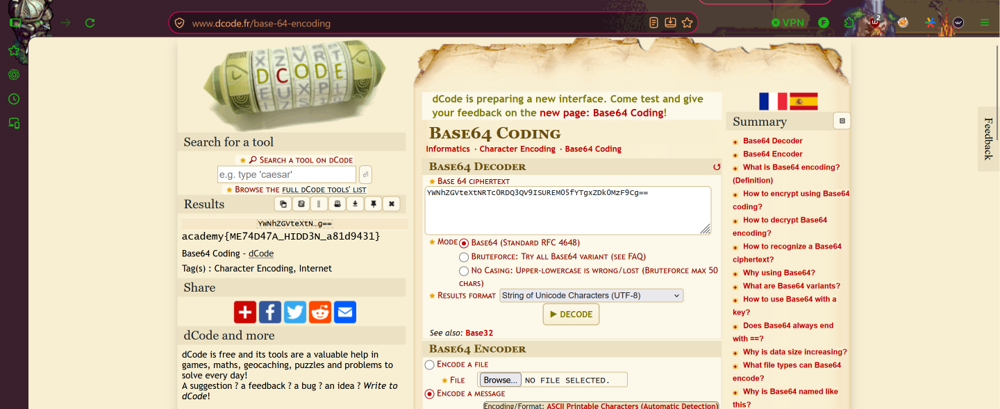

# CanYouSee
**Category:** Forensics  
**Difficulty:** Easy  

## Challenge Description
Pada challenge ini, kita diberikan sebuah file bernama `unknown.zip` dengan deskripsi soal:

> "How about some hide and seek?"

Deskripsi tersebut memberikan petunjuk bahwa terdapat sesuatu yang disembunyikan dan perlu kita temukan melalui proses analisis file.

## Hint
Challenge ini juga memberikan hint:

> "How can you view the information about the picture? If something isn't in the expected form, maybe it deserves attention?"

Hint tersebut mengarahkan kita untuk memeriksa informasi atau detail dari sebuah gambar dan memperhatikan sesuatu yang terlihat tidak biasa.

## Initial Analysis
Berdasarkan deskripsi dan hint yang diberikan, saya menduga bahwa terdapat informasi tersembunyi di dalam sebuah file gambar.

Karena hint menekankan pada informasi mengenai gambar, saya berasumsi bahwa informasi tersebut kemungkinan tidak terlihat secara langsung pada tampilan gambar, melainkan tersimpan di dalam **metadata file**.

Oleh karena itu, langkah yang akan dilakukan adalah mengidentifikasi file, mengekstrak isinya, kemudian memeriksa metadata gambar untuk menemukan informasi yang mencurigakan.

## Step 1 — Identify the Given File
Langkah pertama, kita mengunduh file `unknown.zip` kemudian memeriksa format file tersebut menggunakan perintah:

```bash
file unknown.zip
```

Berdasarkan hasil pemeriksaan, file `unknown.zip` teridentifikasi sebagai sebuah arsip berformat ZIP.



## Step 2 — Extract ZIP Archive
Selanjutnya, kita mengekstrak file ZIP menggunakan perintah:

```bash
unzip unknown.zip
```

Setelah proses ekstraksi berhasil dilakukan, ditemukan sebuah file gambar bernama `ukn_reality.jpg`.



## Step 3 — Inspect the Image
Setelah mendapatkan file `ukn_reality.jpg`, kita membuka gambar tersebut untuk melihat apakah terdapat informasi tersembunyi secara visual.

Namun, setelah diperiksa, gambar hanya menampilkan sebuah ilustrasi dan tidak ditemukan informasi atau flag yang terlihat secara langsung.

Oleh karena itu, kita melanjutkan pemeriksaan terhadap metadata gambar sesuai dengan hint yang diberikan.



## Step 4 — Analyze Image Metadata
Selanjutnya, kita menggunakan **ExifTool** untuk melihat informasi metadata yang tersimpan di dalam gambar.

Jalankan perintah berikut:

```bash
exiftool ukn_reality.jpg
```

Dari hasil pemeriksaan, ditemukan sebuah informasi menarik pada atribut `Attribution URL` yang berisi string berikut:

```text
YWNhZGVteXtNRTc0RDQ3QV9ISUREM05fYTgxZDk0MzF9Cg==
```

String tersebut terlihat mencurigakan karena memiliki pola karakter yang menyerupai **Base64 encoding**, terutama dengan adanya karakter `==` pada bagian akhir.

Oleh karena itu, kita mencoba melakukan decoding untuk mengetahui informasi yang tersembunyi di dalamnya.



## Step 5 — Decode Base64 and Retrieve the Flag
Setelah mendapatkan string tersebut, kita membuka website **dCode** dan menggunakan fitur Base64 Decoder.

Kemudian, kita memasukkan string yang ditemukan pada metadata gambar untuk diterjemahkan menjadi teks biasa.

Setelah proses decoding berhasil dilakukan, ditemukan flag berikut:

```text
academy{ME74D47A_HIDD3N_a81d9431}
```



Dengan demikian, challenge **CanYouSee** berhasil diselesaikan.

## Conclusion
Challenge ini menunjukkan bahwa informasi tersembunyi pada sebuah gambar tidak selalu dapat ditemukan melalui tampilan visualnya, tetapi juga dapat tersimpan di dalam metadata file.

Dengan menggunakan perintah `file`, `unzip`, dan `exiftool`, kita berhasil mengidentifikasi arsip, mengekstrak gambar, serta menemukan string Base64 pada atribut `Attribution URL`.

Setelah string tersebut di-decode, kita berhasil memperoleh flag.

Dari challenge ini, kita belajar pentingnya melakukan **metadata analysis** dalam Digital Forensics serta memahami bahwa informasi yang tampak tidak biasa pada sebuah file dapat menjadi petunjuk untuk menemukan data tersembunyi.