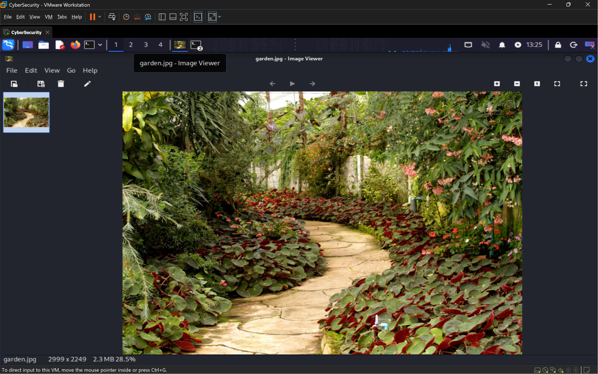
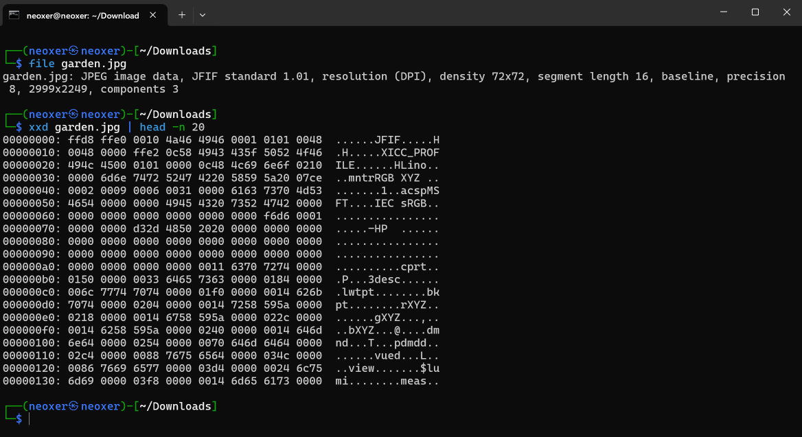
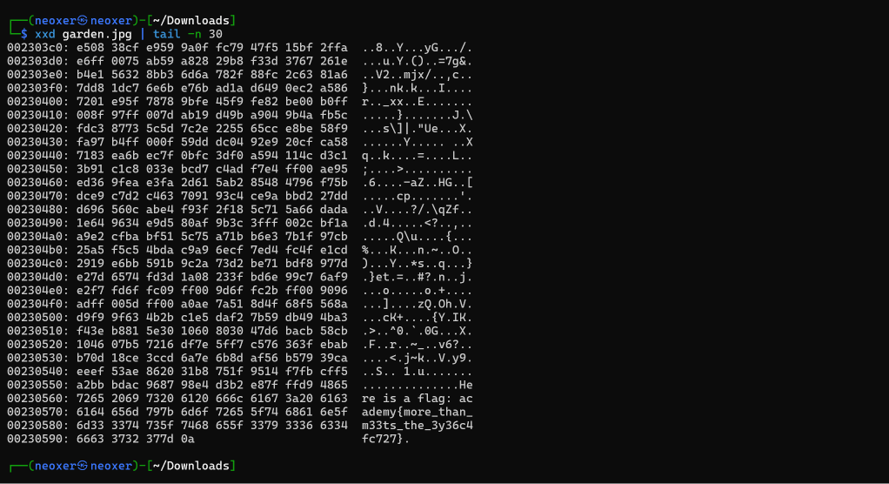

# Flory of the Garden
**Category:** Forensics  
**Difficulty:** Easy  

## Step 1 — Analyze the Given File
Pada challenge ini, kita diberikan sebuah file gambar bernama `garden.jpg` yang menampilkan sebuah taman.

Selain itu, terdapat hint:

> "What is a hex editor?"

Berdasarkan hint tersebut, kita diarahkan untuk memeriksa isi mentah (*raw bytes*) dari file menggunakan hex editor guna menemukan informasi tersembunyi.



## Step 2 — Identify the File Format
Selanjutnya, kita melakukan pemeriksaan terhadap file `garden.jpg` menggunakan terminal dengan menjalankan perintah:

```bash
file garden.jpg
```

Berdasarkan hasil pemeriksaan, file `garden.jpg` teridentifikasi sebagai gambar berformat **JPEG** dengan standar **JFIF 1.01** dan resolusi **2999 × 2249 piksel**.

Hasil ini menunjukkan bahwa file masih dikenali sebagai gambar JPEG.

Kemudian, kita memeriksa bagian awal file dalam bentuk hexadecimal menggunakan perintah:

```bash
xxd garden.jpg | head -n 20
```

Dari hasil pemeriksaan, ditemukan bahwa file diawali dengan byte `FF D8 FF E0`, yang merupakan bagian dari header JPEG. Selain itu, terdapat teks `JFIF` yang menunjukkan bahwa file menggunakan standar JPEG File Interchange Format.



## Step 3 — Inspect the End of the File
Setelah memeriksa bagian awal file, kita melanjutkan analisis dengan memeriksa bagian akhir file menggunakan perintah:

```bash
 xxd garden.jpg | tail -n 30
```

Perintah tersebut digunakan untuk menampilkan 30 baris terakhir dari isi file.

Dari hasil pemeriksaan, ditemukan sebuah teks yang menyerupai format flag dan tersembunyi pada bagian akhir file `garden.jpg`.



## Step 4 — Retrieve the Flag
Setelah menemukan teks tersembunyi pada bagian akhir file, kita berhasil memperoleh flag dari challenge ini.

**Flag:**

```text
academy{more_than_m33ts_the_3y36c4fc727}
```

Dengan demikian, challenge **Flory of the Garden** berhasil diselesaikan.

## Conclusion
Challenge ini menunjukkan bahwa sebuah file gambar dapat menyimpan informasi tersembunyi yang tidak terlihat ketika gambar dibuka secara normal.

Dengan melakukan pemeriksaan terhadap struktur file JPEG menggunakan perintah `file`, `xxd`, dan `tail`, kita berhasil menemukan flag yang tersimpan pada bagian akhir file.

Oleh karena itu, dalam proses Digital Forensics, pemeriksaan isi mentah (*raw bytes*) dan struktur file sangat penting untuk mengidentifikasi informasi tersembunyi yang tidak dapat ditemukan hanya dengan melihat tampilan visual file.