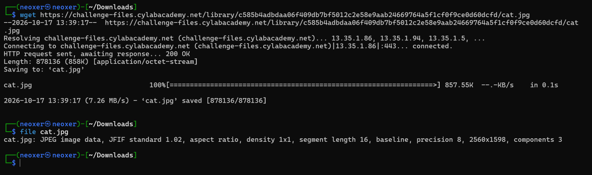
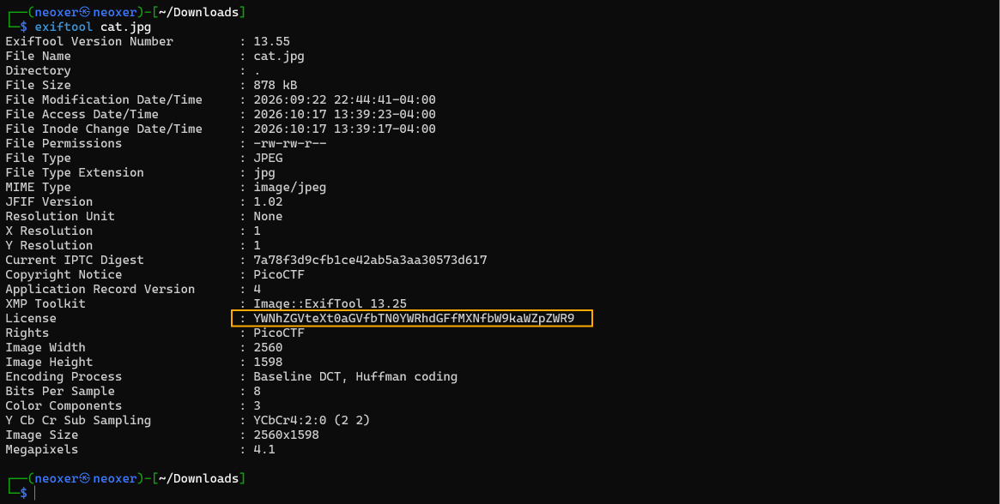
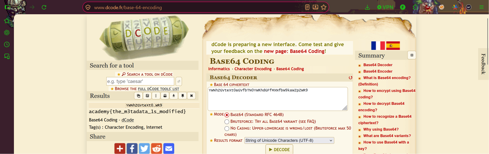

# Information
**Category:** Forensics  
**Difficulty:** Easy  

## Step 1 — Analyze the Given File
Pada challenge ini, kita diberikan sebuah file gambar bernama `cat.jpg` dengan deskripsi:

> "Files can always be changed in a secret way"

Selain itu, terdapat hint:

> "Look at the details of the file"

Berdasarkan hint tersebut, kita diarahkan untuk memeriksa detail atau metadata dari file gambar guna menemukan informasi tersembunyi.

Langkah pertama, kita mengunduh file `cat.jpg` kemudian memeriksa format file menggunakan perintah:

```bash
file cat.jpg
```

Hasil pemeriksaan menunjukkan bahwa file tersebut merupakan gambar berformat JPEG.



## Step 2 — Inspect Image Metadata
Selanjutnya, kita menggunakan tool **ExifTool** untuk memeriksa metadata yang tersimpan di dalam gambar.

Metadata merupakan informasi tambahan pada sebuah file, seperti ukuran gambar, tanggal pembuatan, perangkat yang digunakan, hingga informasi lain yang dapat disisipkan ke dalam file.

Jalankan perintah berikut:

```bash
exiftool cat.jpg
```

Dari hasil pemeriksaan, ditemukan sebuah string mencurigakan pada bagian metadata `License` yang terlihat seperti teks terenkripsi atau terenkode.

```text
YWNhZGVteXt0aGVfbTN0YWRhdGFfMXNfbW9kaWZpZWR9
```

String tersebut memiliki karakteristik encoding **Base64**, sehingga kita perlu melakukan decoding untuk mengetahui isi sebenarnya.



## Step 3 — Decode Base64
Setelah mendapatkan string tersebut, kita membuka website **CyberChef** atau **dCode** untuk melakukan proses decoding.

Pada challenge ini, kita menggunakan dCode dengan memilih fitur **Base64 Decoder**, kemudian memasukkan string yang ditemukan pada metadata gambar.

Hasil decoding menunjukkan bahwa string tersebut merupakan flag yang disembunyikan menggunakan encoding Base64.



## Step 4 — Retrieve the Flag
Setelah proses decoding berhasil, kita mendapatkan flag berikut:

**Flag:**

```text
academy{the_m3tadata_1s_modified}
```

Dengan demikian, challenge **Information** berhasil diselesaikan.

## Conclusion
Challenge ini menunjukkan bahwa informasi tersembunyi tidak selalu berada pada tampilan visual sebuah gambar, tetapi juga dapat disimpan di dalam metadata file.

Dengan menggunakan **ExifTool**, kita berhasil menemukan string Base64 pada metadata `License` yang kemudian dapat diterjemahkan menjadi flag.

Oleh karena itu, pemeriksaan metadata merupakan salah satu langkah penting dalam **Digital Forensics** untuk menemukan informasi tersembunyi di dalam sebuah file.