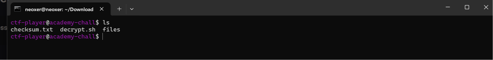
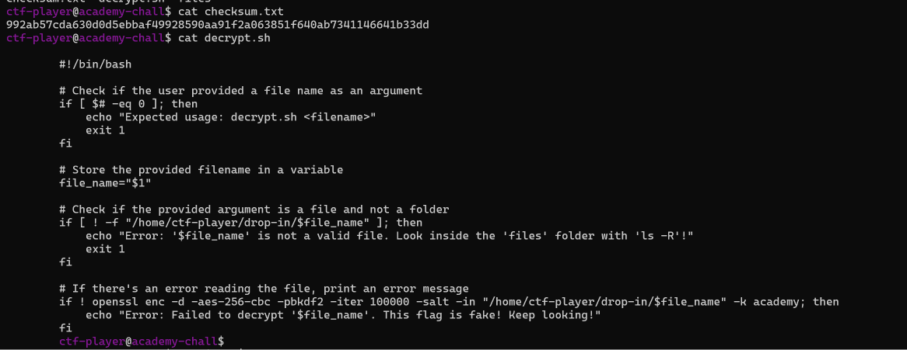
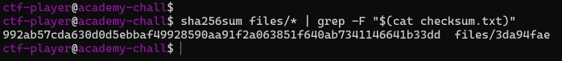
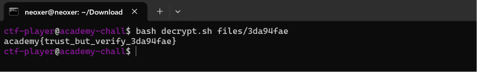

# Verify
**Category:** Forensics  
**Difficulty:** Easy  

## Step 1 — Analyze the Challenge
Pada challenge ini, kita diberikan sejumlah file beserta sebuah nilai hash SHA-256 dan script dekripsi untuk menemukan file asli yang berisi flag.

Berdasarkan deskripsi challenge:

> "People keep trying to trick my players with imitation flags. I want to make sure they get the real thing! I'm going to provide the SHA-256 hash and a decrypt script to help you know that my flags are legitimate."

Selain itu, terdapat hint yang menjelaskan bahwa kita dapat menggunakan perintah `sha256sum` untuk menghitung hash sebuah file dan operator pipe (`|`) untuk menggabungkan beberapa perintah.

Berdasarkan deskripsi dan hint tersebut, kita perlu mencari file yang memiliki nilai hash SHA-256 sesuai dengan checksum yang diberikan.

Langkah pertama, kita memeriksa isi direktori menggunakan perintah:

```bash
ls
```

Dari hasil pemeriksaan, ditemukan dua file, yaitu `checksum.txt` dan `decrypt.sh`, serta sebuah folder bernama `files` yang berisi sejumlah file untuk diperiksa.



## Step 2 — Inspect Checksum and Decryption Script
Selanjutnya, kita memeriksa isi file `checksum.txt` dan script `decrypt.sh` menggunakan perintah:

```bash
cat checksum.txt
cat decrypt.sh
```

File `checksum.txt` berisi nilai hash SHA-256 yang digunakan sebagai acuan untuk menentukan file asli.

Sementara itu, `decrypt.sh` merupakan script yang digunakan untuk mendekripsi file setelah file yang sesuai berhasil ditemukan. Dari pemeriksaan script, diketahui bahwa proses dekripsi membutuhkan path file sebagai argumen.



## Step 3 — Find the Matching File
Setelah mengetahui nilai checksum dan cara kerja script, kita mencari file yang memiliki hash SHA-256 sesuai dengan nilai di dalam `checksum.txt`.

Jalankan perintah berikut:

```bash
sha256sum files/* | grep -F "$(cat checksum.txt)"
```

Penjelasan command:

| Command | Fungsi |
|---|---|
| `sha256sum files/*` | Menghitung hash SHA-256 seluruh file di dalam folder `files` |
| `\|` | Meneruskan output dari perintah pertama ke perintah berikutnya |
| `grep -F` | Mencari teks yang cocok secara literal |
| `$(cat checksum.txt)` | Mengambil nilai hash dari file `checksum.txt` |

Perintah tersebut akan menghitung hash seluruh file, kemudian menampilkan file yang nilai hash-nya cocok dengan checksum yang diberikan.

Dari hasil pemeriksaan, ditemukan file yang sesuai, yaitu:

```text
files/3da94fae
```

Dengan demikian, kita berhasil mengidentifikasi file yang memiliki checksum sesuai dengan nilai referensi.



## Step 4 — Decrypt the File and Retrieve the Flag
Setelah menemukan file yang sesuai, kita menjalankan script `decrypt.sh` untuk melakukan proses dekripsi.

Jalankan perintah berikut:

```bash
bash decrypt.sh files/3da94fae
```

Perintah tersebut menjalankan script dekripsi dengan file `3da94fae` sebagai argumen.

Setelah proses dekripsi berhasil dilakukan, terminal menampilkan flag dari challenge ini.



**Flag:**

```text
academy{trust_but_verify_3da94fae}
```

Dengan demikian, challenge **Verify** berhasil diselesaikan.

## Conclusion
Challenge ini menunjukkan bagaimana hash SHA-256 dapat digunakan untuk memverifikasi integritas file dan membedakan file yang sesuai dengan checksum referensi dari file lainnya.

Dengan menggunakan perintah `sha256sum` dan `grep`, kita berhasil menemukan file yang memiliki nilai hash sesuai dengan `checksum.txt`. Selanjutnya, file tersebut didekripsi menggunakan script `decrypt.sh` hingga menghasilkan flag.

Oleh karena itu, pemahaman mengenai **file integrity verification**, hashing, dan penggunaan command Linux sangat penting dalam proses Digital Forensics untuk memastikan bahwa file yang dianalisis sesuai dengan data referensi yang terpercaya.