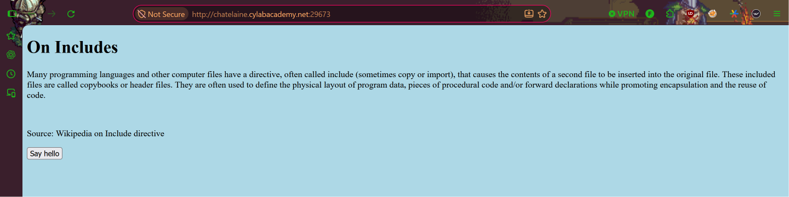
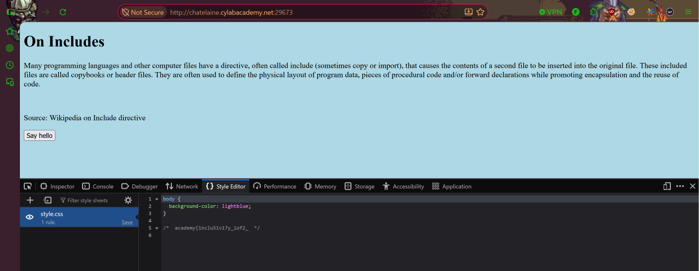
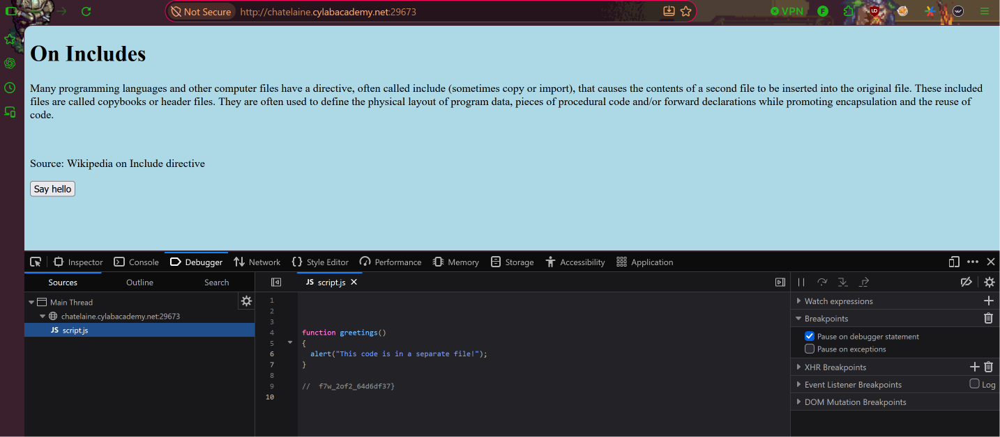

# Includes
**Category:** Web Exploitation  
**Difficulty:** Easy  

## Step 1 — Access the Website
Pada challenge ini, kita diberikan sebuah website sederhana yang menampilkan halaman berjudul **On Includes**. Untuk menemukan flag, kita perlu melakukan pemeriksaan terhadap source code dan file yang digunakan oleh website tersebut.



## Step 2 — Inspect CSS File
Selanjutnya, kita melakukan **Inspect Element** dengan menekan `F12` atau klik kanan → **Inspect**.

Kemudian, kita membuka file `style.css` melalui Developer Tools. Setelah memeriksa isi file tersebut, ditemukan potongan flag pertama yang disembunyikan di dalam source code CSS.

Potongan flag pertama:

`academy{1nclu51v17y_1of2_`



## Step 3 — Inspect JavaScript File
Setelah mendapatkan potongan flag pertama, kita berpindah ke tab **Debugger** pada Developer Tools untuk memeriksa file JavaScript.

Kemudian, kita membuka file `script.js` dan menemukan potongan flag kedua yang tersimpan di dalam source code JavaScript.

Potongan flag kedua:

`f7w_2of2_64d6df37}`



## Step 4 — Combine the Flag
Setelah mendapatkan kedua potongan flag, kita menggabungkannya sesuai urutan untuk memperoleh flag yang lengkap.

**Flag:**

```text
academy{1nclu51v17y_1of2_f7w_2of2_64d6df37}
```

Dengan demikian, challenge **Includes** berhasil diselesaikan.

## Conclusion
Challenge ini menunjukkan bahwa informasi yang tersimpan di dalam file CSS dan JavaScript dapat diakses dan diperiksa melalui Developer Tools pada browser.

Dengan melakukan inspeksi terhadap file `style.css` dan `script.js`, kita berhasil menemukan dua potongan flag yang kemudian digabungkan menjadi satu flag utuh.

Oleh karena itu, informasi sensitif sebaiknya tidak disimpan di dalam file frontend yang dapat diakses secara publik.