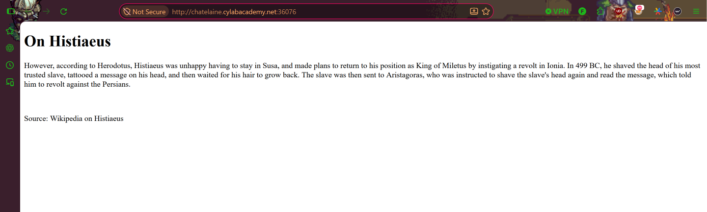
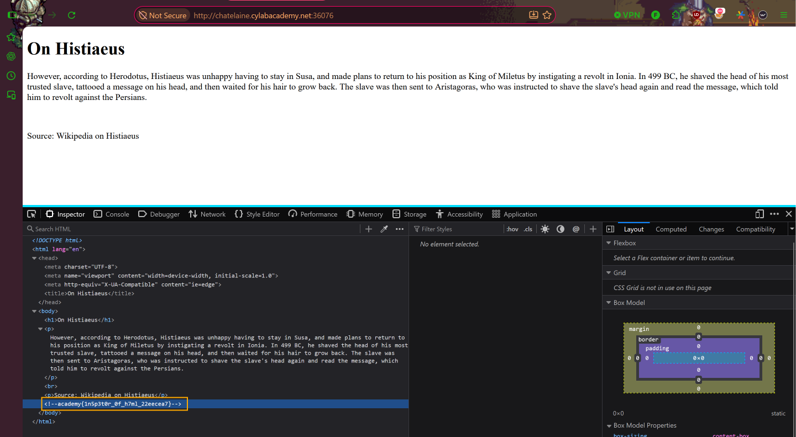

# Inspect HTML

**Category:** Web Exploitation  
**Difficulty:** Easy  

## Step 1 — Access the Website

Pada challenge ini, kita diberikan sebuah website yang menampilkan halaman berisi informasi mengenai Histiaeus.

## Step 2 — Inspect Element

Selanjutnya, kita melakukan **Inspect Element** dengan menekan `F12` atau klik kanan → **Inspect**.

Pada bagian HTML, ditemukan sebuah komentar yang berisi flag tersembunyi. Dengan demikian, flag berhasil ditemukan tanpa perlu melakukan eksploitasi lebih lanjut.

## Conclusion

Challenge ini menunjukkan bahwa informasi sensitif yang disimpan dalam komentar HTML tetap dapat dilihat oleh pengguna melalui Developer Tools pada browser.

