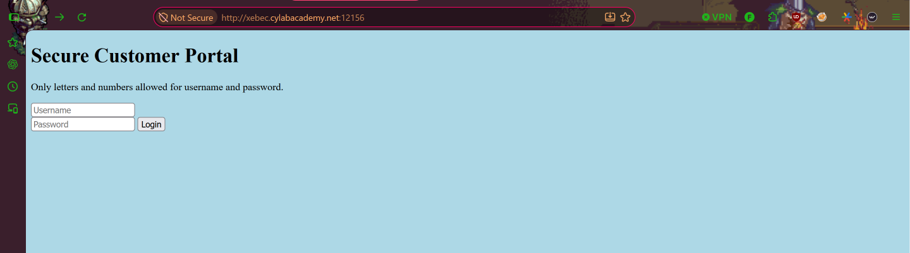
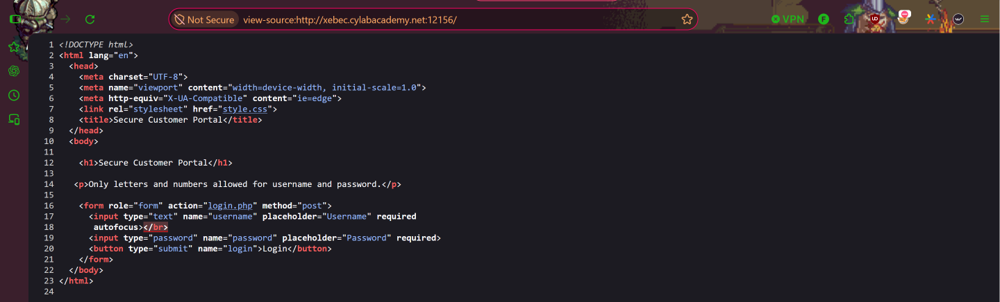
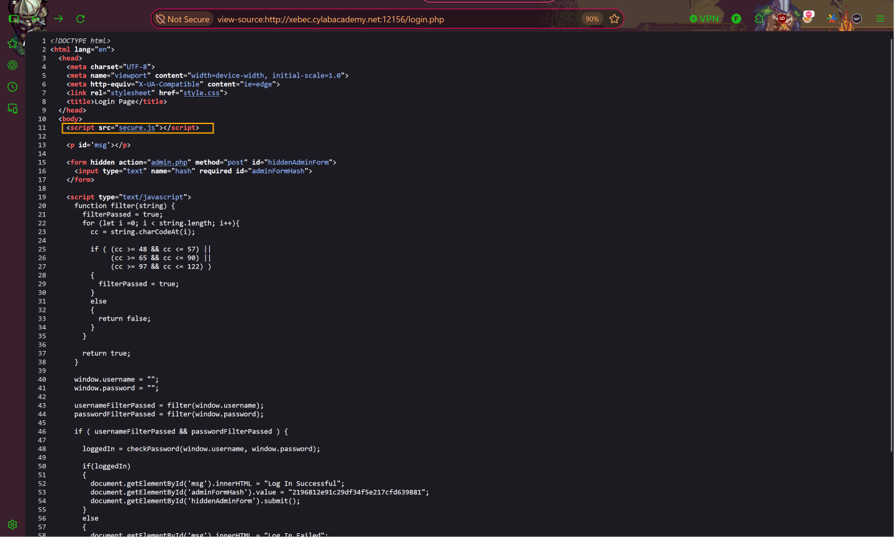
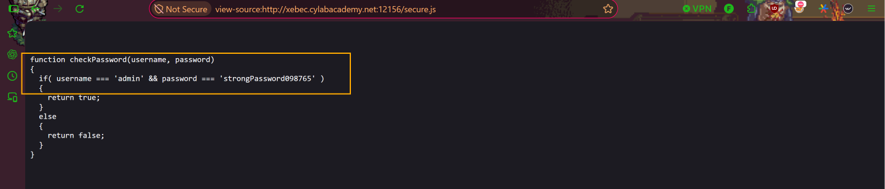
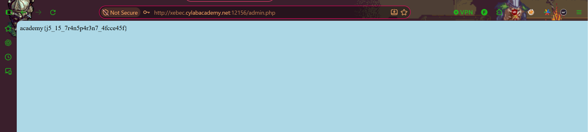

# Local Authority
**Category:** Web Exploitation  
**Difficulty:** Easy  

## Step 1 — Access the Website
Pada challenge ini, kita diberikan sebuah halaman login yang memiliki dua kolom input, yaitu **username** dan **password**. Untuk menyelesaikan challenge, kita perlu menemukan kredensial yang dapat digunakan untuk login ke dalam sistem.

## Step 2 — Inspect Source Code
Selanjutnya, kita menekan `Ctrl + U` untuk melihat source code halaman website. Setelah memeriksa kode HTML yang ditampilkan, ditemukan referensi menuju file `login.php`. Kemudian, kita membuka file tersebut untuk melakukan analisis lebih lanjut.

## Step 3 — Discover JavaScript File
Setelah memeriksa source code, ditemukan adanya file JavaScript bernama `secure.js`. File ini menarik untuk diperiksa karena berpotensi menyimpan informasi yang berkaitan dengan mekanisme autentikasi pada halaman login.

## Step 4 — Retrieve Admin Credentials
Setelah membuka file `secure.js`, ditemukan informasi berupa **username** dan **password** milik admin yang tersimpan secara langsung di dalam kode JavaScript.

Selanjutnya, kita menyalin kredensial tersebut untuk digunakan pada halaman login.

## Step 5 — Login and Retrieve the Flag
Setelah mendapatkan kredensial admin, kita kembali ke halaman login dan memasukkan username serta password yang telah ditemukan.

Proses autentikasi berhasil dilakukan dan sistem menampilkan flag. Dengan demikian, challenge **Local Authority** berhasil diselesaikan.

## Conclusion
Challenge ini menunjukkan bahwa menyimpan informasi sensitif seperti username dan password di dalam file JavaScript yang dapat diakses publik merupakan praktik keamanan yang tidak aman.

Meskipun file JavaScript digunakan untuk mendukung fungsionalitas website, isi file tersebut tetap dapat diperiksa oleh pengguna melalui browser.

Oleh karena itu, kredensial dan proses validasi autentikasi seharusnya dikelola secara aman di sisi server, bukan disimpan secara langsung pada source code yang dapat diakses oleh pengguna.