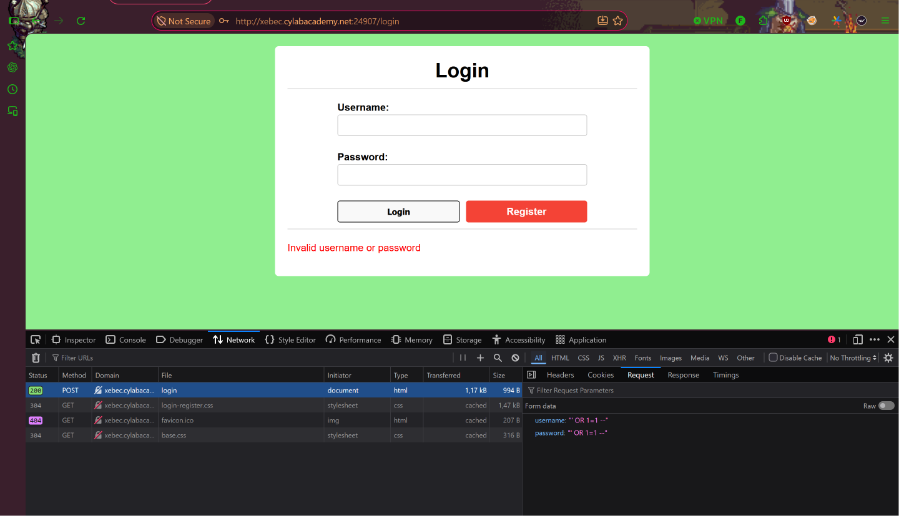
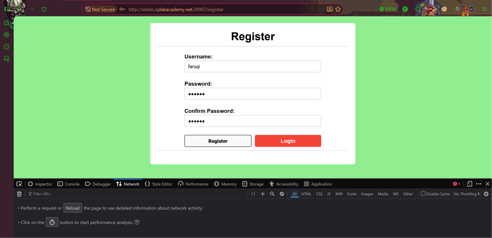
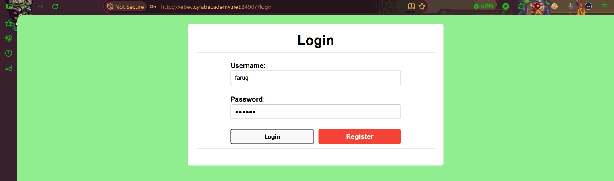
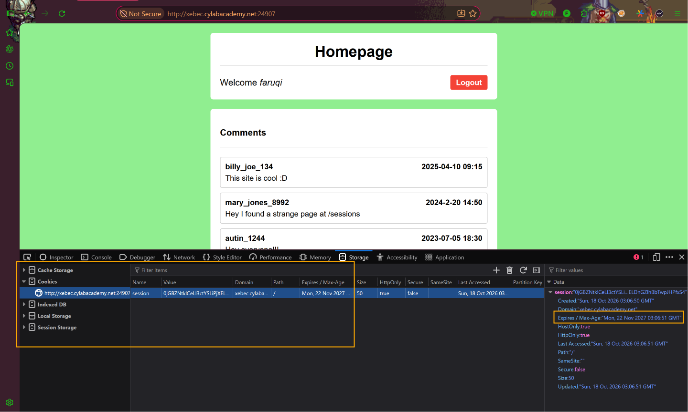
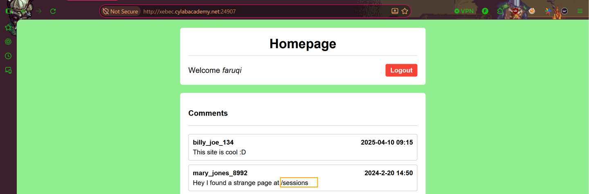
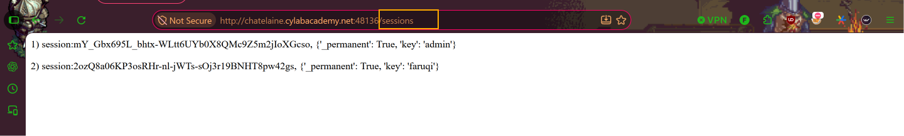
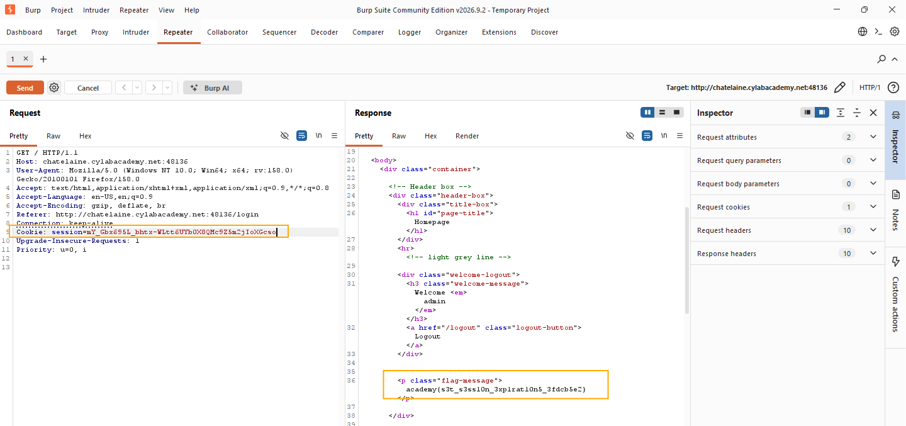

# Old Sessions
**Category:** Web Exploitation  
**Difficulty:** Easy  

## Challenge Description
Pada challenge ini, kita diberikan sebuah website yang memiliki sistem login dan registrasi pengguna.

Berdasarkan deskripsi challenge:

> "Proper session timeout controls are critical for securing user accounts. If a user logs in on a public or shared computer but doesn’t explicitly log out (instead simply closing the browser tab), and session expiration dates are misconfigured, the session may remain active indefinitely.
>
> This then allows an attacker using the same browser later to access the user’s account without needing credentials, exploiting the fact that sessions never expire and remain authenticated."

Deskripsi tersebut menjelaskan bahwa pengelolaan masa berlaku sesi yang tidak tepat dapat menyebabkan pengguna tetap terautentikasi meskipun telah menutup browser tanpa melakukan logout.

## Hint
Challenge ini memberikan hint:

> "Do you know how to use the web inspector? Where are cookies stored?"

Hint tersebut mengarahkan kita untuk menggunakan **Developer Tools** dan memeriksa cookie yang tersimpan pada browser.

## Initial Analysis
Berdasarkan deskripsi dan hint, saya menduga bahwa challenge ini memiliki kerentanan pada mekanisme **Session Management**, khususnya terkait masa berlaku session cookie.

Apabila session cookie masih valid dan dapat digunakan kembali, seseorang yang memiliki cookie tersebut berpotensi mengakses akun pengguna tanpa mengetahui username dan password.

Oleh karena itu, saya mencoba melakukan login, memeriksa cookie menggunakan Developer Tools, dan mencari kemungkinan adanya sesi pengguna lain yang masih aktif.

## Step 1 — Access the Website
Pada challenge ini, kita diberikan sebuah website yang menampilkan halaman login dengan kolom username dan password.


## Step 2 — Test SQL Injection
Langkah pertama, kita mencoba melakukan login menggunakan payload SQL Injection untuk mengetahui apakah proses autentikasi dapat dilewati.

Payload yang digunakan:

```sql
' OR 1=1 --
```

Payload tersebut dicoba pada kolom username dan password. Namun, setelah melakukan login, sistem menampilkan pesan bahwa kredensial tidak valid.

Dengan demikian, percobaan SQL Injection tersebut tidak berhasil melewati proses autentikasi.



## Step 3 — Register a New Account
Karena percobaan sebelumnya tidak berhasil, kita mencoba melakukan registrasi akun melalui halaman **Register**.

Pada tahap ini, kita membuat akun baru yang nantinya digunakan untuk mengakses halaman utama website dan memeriksa mekanisme session yang diterapkan.



## Step 4 — Login and Inspect Session Cookies
Setelah registrasi berhasil, kita kembali ke halaman login dan masuk menggunakan username serta password yang telah didaftarkan.



Setelah berhasil login, kita membuka **Developer Tools** dengan menekan `F12`, kemudian menuju tab **Storage → Cookies**.

Dari hasil pemeriksaan, ditemukan sebuah session cookie yang digunakan website untuk mempertahankan status login pengguna.

Selain itu, terlihat bahwa cookie tersebut memiliki waktu kedaluwarsa yang cukup lama, yaitu:

```text
Mon, 22 Nov 2027 03:06:51 GMT
```

Hal ini menarik karena sesuai dengan deskripsi challenge yang membahas masalah session expiration.



## Step 5 — Discover the Sessions Endpoint
Setelah berhasil masuk ke halaman utama, ditemukan sebuah komentar yang menarik:

> "Hey I found a strange page at /sessions"

Komentar tersebut memberikan petunjuk mengenai sebuah endpoint bernama `/sessions`.

Selanjutnya, kita membuka endpoint tersebut untuk mengetahui informasi yang tersedia.



## Step 6 — Identify Admin Session
Setelah mengakses endpoint `/sessions`, kita menemukan informasi mengenai beberapa session pengguna yang masih tersimpan, termasuk session milik admin dan akun yang kita gunakan.

Berikut informasi yang ditemukan:

**Session Admin:**

```text
session: mY_Gbx695L_bhtx-WLtt6UYb0X8QMc9Z5m2jIoXGcso
{'_permanent': True, 'key': 'admin'}
```

**Session Pengguna:**

```text
session: 2ozQ8a06KP3osRHr-nl-jWTs-sOj3r19BNHT8pw42gs
{'_permanent': True, 'key': 'faruqi'}
```

Dari informasi tersebut, terlihat bahwa kedua session memiliki atribut `_permanent: True` dan masing-masing terhubung dengan akun yang berbeda.

Hal ini menunjukkan bahwa endpoint `/sessions` mengekspos informasi session pengguna lain, termasuk session milik administrator.



## Step 7 — Session Hijacking Using Burp Suite
Setelah menemukan session admin, kita mencoba menggunakan session tersebut untuk mengakses website sebagai administrator.

Langkah pertama, kita kembali melakukan login sambil menjalankan **Burp Suite** untuk menangkap HTTP request yang dikirim oleh browser.

Kemudian, kita mengaktifkan fitur **Intercept** pada Burp Suite dan menangkap request yang membawa session cookie milik pengguna.

Pada bagian HTTP Header `Cookie`, kita mengganti nilai session pengguna dengan session milik admin yang sebelumnya ditemukan pada endpoint `/sessions`.

Contoh perubahan:

```http
Cookie: session=mY_Gbx695L_bhtx-WLtt6UYb0X8QMc9Z5m2jIoXGcso
```

Setelah melakukan perubahan, kita meneruskan request menggunakan fitur **Forward**.

Hasilnya, server menerima session admin tersebut dan memberikan akses ke informasi yang sebelumnya tidak dapat diakses oleh akun biasa.



## Step 8 — Retrieve the Flag
Setelah berhasil menggunakan session milik administrator, website menampilkan flag yang menjadi tujuan challenge.

**Flag:**

```text
academy{s3t_s3ss10n_3xp1rat10n5_3fdcb5e2}
```

Dengan demikian, challenge **Old Sessions** berhasil diselesaikan.

## Conclusion
Challenge ini menunjukkan adanya kelemahan pada mekanisme **Session Management** dan pengendalian akses terhadap informasi session pengguna.

Melalui endpoint `/sessions`, kita berhasil menemukan session milik administrator yang masih valid. Session tersebut kemudian digunakan untuk menggantikan session pengguna biasa melalui manipulasi HTTP request menggunakan Burp Suite.

Kerentanan ini memungkinkan terjadinya **Session Hijacking**, yaitu ketika seseorang menggunakan session milik pengguna lain untuk memperoleh akses tanpa mengetahui kredensial login.

Oleh karena itu, aplikasi web seharusnya menerapkan masa berlaku session yang sesuai, membatalkan session saat logout, melindungi session token dari akses pengguna lain, serta memastikan endpoint sensitif tidak mengekspos informasi autentikasi.