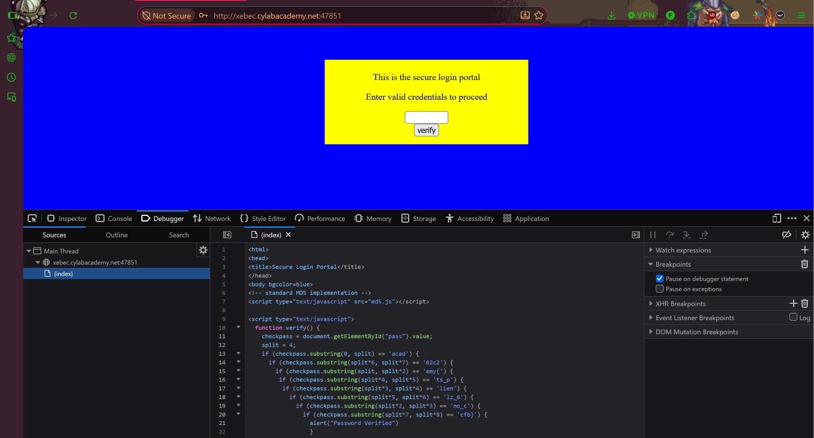

# dont-use-client-side
**Category:** Web Exploitation  
**Difficulty:** Easy  

## Step 1 — Access the Website
Pada challenge ini, kita diberikan sebuah website yang menampilkan halaman verifikasi password. Untuk menyelesaikan challenge, kita perlu menemukan password yang benar dengan menganalisis mekanisme validasi yang digunakan oleh website.



## Step 2 — Inspect Source Code
Selanjutnya, kita melakukan **Inspect Element** dengan menekan `F12` atau klik kanan → **Inspect**.

Setelah memeriksa source code website, ditemukan sebuah fungsi JavaScript yang digunakan untuk memvalidasi password melalui beberapa kondisi `if` dan metode `substring()`.

Berikut potongan kode yang ditemukan:

```javascript
if (checkpass.substring(0, split) == 'acad') {
  if (checkpass.substring(split*6, split*7) == '62c2') {
    if (checkpass.substring(split, split*2) == 'emy{') {
      if (checkpass.substring(split*4, split*5) == 'ts_p') {
        if (checkpass.substring(split*3, split*4) == 'lien') {
          if (checkpass.substring(split*5, split*6) == 'lz_6') {
            if (checkpass.substring(split*2, split*3) == 'no_c') {
              if (checkpass.substring(split*7, split*8) == 'cfb}') {
                alert("Password Verified")
              }
            }
          }
        }
      }
    }
  }
}
```
## Step 3 — Analyze Password Validation
Setelah menganalisis kode tersebut, diketahui bahwa metode `substring()` digunakan untuk mengambil bagian tertentu dari password berdasarkan posisi indeks.

Setiap kondisi `if` memeriksa potongan password yang berbeda. Namun, urutan pemeriksaan pada source code tidak sesuai dengan urutan karakter password yang sebenarnya.

Oleh karena itu, kita perlu menyusun kembali setiap potongan berdasarkan indeks yang digunakan.

Berikut hasil penyusunannya:

| Urutan | Potongan |
|---|---|
| 1 | `acad` |
| 2 | `emy{` |
| 3 | `no_c` |
| 4 | `lien` |
| 5 | `ts_p` |
| 6 | `lz_6` |
| 7 | `62c2` |
| 8 | `cfb}` |

## Step 4 — Retrieve the Flag
Setelah seluruh potongan disusun sesuai urutannya, kita berhasil mendapatkan password yang merupakan flag dari challenge ini.

**Flag:**

```text
academy{no_clients_plz_662c2cfb}
```

Dengan demikian, challenge **dont-use-client-side** berhasil diselesaikan.

## Conclusion
Challenge ini menunjukkan bahwa melakukan validasi password menggunakan JavaScript di sisi client merupakan praktik keamanan yang tidak aman.

Meskipun password dipecah menjadi beberapa bagian dan diperiksa menggunakan metode `substring()`, seluruh proses validasi tetap dapat dilihat melalui Developer Tools pada browser.

Oleh karena itu, proses autentikasi dan validasi password seharusnya dilakukan di sisi server agar informasi sensitif tidak dapat diperoleh dengan mudah melalui pemeriksaan source code.