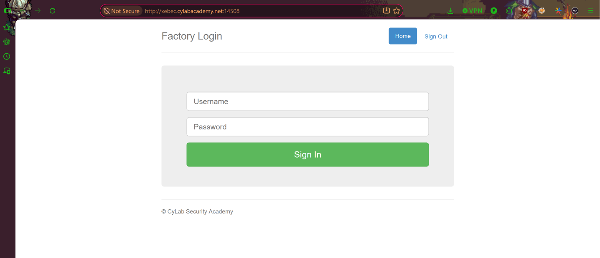
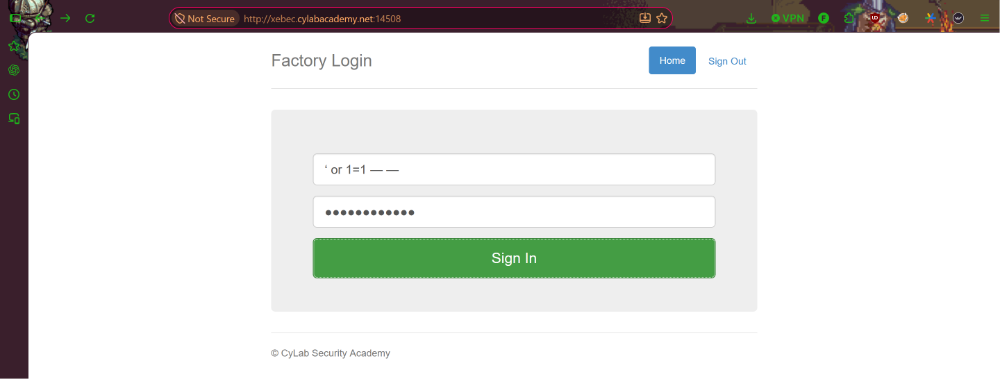
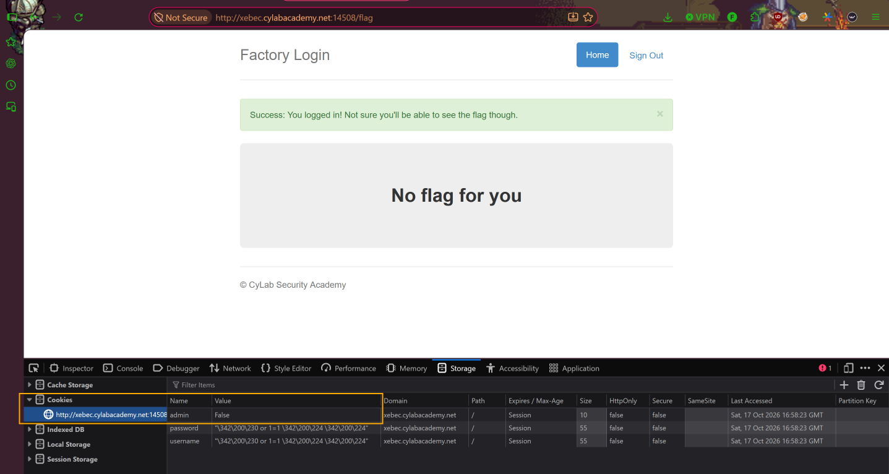
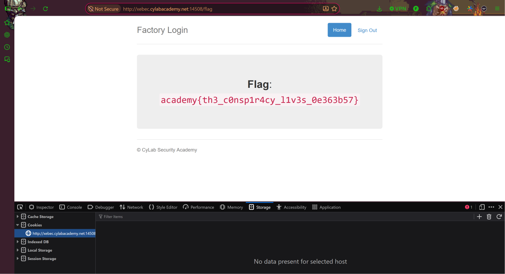

# Logon
**Category:** Web Exploitation  
**Difficulty:** Easy  

## Step 1 — Access the Website
Pada challenge ini, kita diberikan sebuah halaman login yang memiliki dua kolom input, yaitu **username** dan **password**.

Berdasarkan deskripsi challenge:

> "The factory is hiding things from all of its users. Can you login as Joe and find what they've been looking at?"

Kita diminta untuk melakukan login dan menemukan informasi tersembunyi yang berupa flag.



## Step 2 — Login Using SQL Injection
Selanjutnya, kita mencoba melakukan login dengan memasukkan payload SQL Injection pada kolom username dan password untuk melewati proses autentikasi.

Payload yang digunakan:

```sql
' OR 1=1 --
```

Payload tersebut dimasukkan pada kedua kolom login, kemudian kita menekan tombol **Sign In**.



## Step 3 — Inspect Cookies
Setelah melakukan login, kita berhasil masuk ke dalam website. Namun, halaman yang ditampilkan masih menunjukkan pesan **"No flag for you"**, sehingga flag belum dapat diperoleh.

Selanjutnya, kita membuka **Developer Tools** dengan menekan `F12`, kemudian berpindah ke tab **Storage → Cookies**.

Setelah memeriksa cookie yang tersimpan, ditemukan sebuah cookie bernama `admin` dengan nilai `False`.



## Step 4 — Modify Admin Cookie
Setelah menemukan cookie tersebut, kita mencoba mengubah nilai cookie `admin` dari `False` menjadi `True` secara manual melalui Developer Tools.

Perubahan yang dilakukan:

```text
admin = False → True
```

Kemudian, kita melakukan **reload** pada halaman website agar perubahan cookie diterapkan.

Setelah halaman dimuat ulang, website berhasil menampilkan flag yang sebelumnya tersembunyi.



## Conclusion
Challenge ini menunjukkan adanya kelemahan keamanan pada mekanisme autentikasi dan otorisasi website.

Melalui manipulasi cookie `admin`, kita dapat memperoleh akses terhadap informasi yang seharusnya hanya tersedia bagi administrator.

Hal ini terjadi karena aplikasi mempercayai nilai cookie yang dapat dimodifikasi oleh pengguna untuk menentukan hak akses.

Oleh karena itu, proses autentikasi dan otorisasi seharusnya divalidasi secara aman di sisi server, bukan hanya mengandalkan nilai cookie yang dikendalikan oleh client.